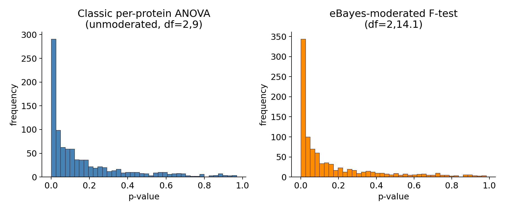
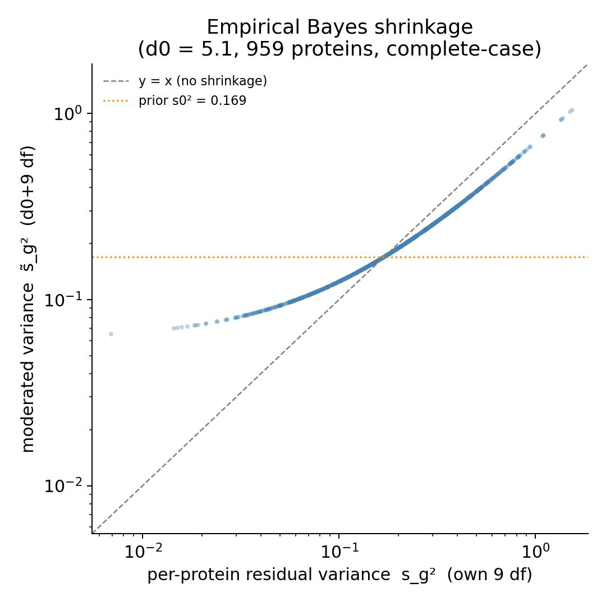

Three conditions, four replicates each, a few thousand proteins. The obvious move is to run a one-way ANOVA on every protein and rank them by p-value. It is also, on its own, not a safe default — and the reason has nothing to do with ANOVA being "outdated." It has to do with what happens when you estimate variance from four numbers and repeat that thousands of times.

This post is the third in the LFQ proteomics series, after [missing data imputation]({{ site.baseurl }}/missing-data-imputation-lfq-proteomics/) and the [full pipeline walkthrough]({{ site.baseurl }}/lfq-proteomics-pipeline-raw-to-report/). Both of those posts used `limma`'s empirical Bayes moderation without explaining why it is there instead of a plain ANOVA. This one closes that gap, with a comparison on the same CTRL/KO/WT dataset ([PXD031582](https://www.ebi.ac.uk/pride/archive/projects/PXD031582)) used throughout the series.

## First, a correction to a common framing

"ANOVA vs. limma" is a slightly misleading way to pose this question, and worth fixing before going further: **they are the same model.** A one-way ANOVA is a linear model with a categorical predictor. `limma::lmFit()` fits exactly that linear model, protein by protein. The difference between "classic ANOVA" and what `limma::eBayes()` does is not the model — it is how the *residual variance* that feeds the F-statistic gets estimated. Classic ANOVA uses each protein's own 4-replicates-per-group variance in isolation. limma borrows information across every other protein tested in the same experiment to produce a more stable estimate of that same quantity. Keeping this straight matters, because "ANOVA is wrong, use eBayes instead" invites the conclusion that they answer different questions. They don't. They estimate the same thing with a different amount of information.

## Why per-protein variance estimation is fragile

With 4 replicates per condition, the residual degrees of freedom for a 3-group one-way ANOVA are `12 - 3 = 9`. Nine degrees of freedom is not a lot to pin down a variance. A protein whose true variance is unremarkable can, by chance, show a very low sample variance in this particular set of 12 measurements — and a low denominator inflates the F-statistic, producing a p-value that looks like discovery but is really a sampling artifact. The opposite happens too: a protein with real signal can land a high sample variance by chance and disappear below threshold.

Fit that model thousands of times, once per protein, and both failure modes occur constantly — some proteins get flattering variance estimates, others unflattering ones, purely from four numbers apiece. The multiple-testing correction downstream (BH, in this pipeline) does not fix this; it only asks how many false discoveries you tolerate among however many proteins the (possibly noisy) per-protein test called significant in the first place. If the input p-values are unstable, the corrected ones inherit that instability.

## What empirical Bayes moderation actually does

Smyth (2004)[^1] models each protein's residual variance as coming from a common prior distribution shared across all proteins in the experiment:

$$\frac{1}{\sigma_g^2} \sim \frac{1}{d_0 s_0^2}\chi^2_{d_0}$$

Fitting that prior to the observed spread of per-protein sample variances yields two numbers: $d_0$ (how many "extra degrees of freedom" the prior is worth) and $s_0^2$ (the typical variance level across the experiment). The moderated variance for protein $g$ is then a degrees-of-freedom-weighted average of its own variance and that prior:

$$\tilde{s}_g^2 = \frac{d_0 s_0^2 + d_g s_g^2}{d_0 + d_g}$$

A protein with an implausibly low sample variance gets pulled up toward $s_0^2$; a protein with a very high one gets pulled down, but by a smaller relative amount once real signal dominates. The moderated F-test then runs with $d_0 + d_g$ denominator degrees of freedom instead of $d_g$ — more degrees of freedom, and a less noisy denominator. This is the full derivation already documented in this repository's [`DEP_hypothesis_testing_guide.md`](https://github.com/SLopezBegines/Proteomics/blob/main/docs/DEP_hypothesis_testing_guide.md); this post applies it specifically against a classic ANOVA rather than assuming the reader already accepts the moderated version.

## A worked comparison, on real data

To isolate the variance-estimator question from the imputation question covered in the [previous post]({{ site.baseurl }}/missing-data-imputation-lfq-proteomics/), this comparison uses only proteins with **zero missing values across all 12 samples** of the CTRL/KO/WT dataset — 959 of 2,646 proteins after contaminant removal. No imputation, no missing-value modeling; the only thing that differs between the two columns below is how the residual variance is estimated.

For each of the 959 proteins: a classic one-way ANOVA (`df1 = 2, df2 = 9`) and an empirical-Bayes-moderated F-test using the shared prior fitted across all 959 proteins simultaneously.

| | Classic ANOVA | eBayes-moderated F-test |
|---|---|---|
| Denominator df | 9 (own replicates only) | 14.1 (9 + fitted d0 = 5.05) |
| Significant, raw p < 0.05 | 396 | 446 |
| Significant, BH-adjusted p < 0.05 | 199 | 305 |

Fitted prior: $d_0 = 5.05$, $s_0^2 = 0.169$ (log2 scale). Of the 199 vs. 305 BH-significant proteins, 183 are called by both methods, 16 are significant only under the classic ANOVA, and 122 are significant only under moderation.

{: style="width: 95%; display: block; margin: 0 auto;"}

Both histograms show the expected shape — a spike near zero (true signal) on a roughly flat background (the null proteins) — which is itself a check worth doing before trusting either method: a distribution enriched near 1 instead of 0, or perfectly flat everywhere, would mean something upstream is misspecified. Here neither distribution shows that, and the moderated version has a visibly taller spike at the low end and a less noisy tail, consistent with a more efficient test rather than an inflated one.

The shrinkage itself is easier to see directly:

{: style="width: 68%; display: block; margin: 0 auto;"}

Proteins with implausibly low own-variance (bottom-left) get pulled up the most in relative terms; proteins with high variance get pulled down slightly; proteins near the prior itself barely move. This is the mechanism, not just the outcome: the 16 proteins significant only under the classic ANOVA are disproportionately proteins whose own variance was small enough to be suspicious — exactly the failure mode moderation is designed to correct. The 122 gained only under moderation are proteins with moderate effect sizes whose own noisy variance estimate, at only 9 df, had been enough to push them just past the 0.05 threshold on the classic side under BH correction — an easier bar to clear with 14.1 denominator df instead of 9.

### Reproducing this in R

The production pipeline for this dataset uses `DEP::analyze_dep()`, which wraps `limma` internally (see the [pipeline post]({{ site.baseurl }}/lfq-proteomics-pipeline-raw-to-report/)). Stripped to plain `limma`, the equivalent of the comparison above is:

``` r
library(limma)

# Classic, unmoderated: fit and test each protein independently — no
# information is shared across proteins.
classic_p <- apply(log2_mat, 1, function(y) {
  summary(aov(y ~ condition))[[1]][["Pr(>F)"]][1]
})

# eBayes-moderated: same linear model, but the residual variance for every
# protein borrows strength from the other 958 fitted in the same call.
design <- model.matrix(~0 + condition)
colnames(design) <- levels(condition)

fit <- lmFit(log2_mat, design)

cont.matrix <- makeContrasts(
  KO_vs_CTRL = KO - CTRL,
  WT_vs_CTRL = WT - CTRL,
  levels = design
)

fit2 <- eBayes(contrasts.fit(fit, cont.matrix))

# Joint 2-df F-test across both contrasts == the moderated equivalent of the
# one-way ANOVA omnibus test.
mod_results <- topTableF(fit2, number = Inf)
```

**A methods note, in the interest of not overstating this:** the R/Bioconductor environment used to draft this post was not available in the analysis sandbox, so the numbers above come from a direct Python reimplementation of Smyth's method-of-moments estimator for $d_0$ and $s_0^2$ (`scipy.special.digamma`/`polygamma`, matching `limma::fitFDist` and `limma::trigammaInverse`), not from calling `limma` itself. Before trusting it on the real data, I validated it against synthetic protein variances simulated from a known $d_0=8$, $s_0^2=2$ prior: the fit recovered $\hat{d}_0=8.30$, $\hat{s}_0^2=2.011$, and the known edge cases behaved correctly (constant input variances → $d_0 \to \infty$; highly heterogeneous true variances → small $d_0$, i.e. little pooling). Running the R code above on the same dataset is the way to get bit-exact `limma` output; the numbers here should match it closely but are not guaranteed to match to the decimal.

## Where empirical Bayes moderation can go wrong

Moderation is not a free upgrade, and treating it as one invites the same overconfidence problem in a different place.

**It assumes exchangeability of variances across the tested features.** The prior is one shared distribution fitted across all proteins in the call. If the protein set mixes genuinely low-noise structural proteins with genuinely high-noise signaling proteins as distinct populations rather than a continuum, a single global prior can over-shrink one group and under-shrink the other. limma's variance-trend option (`trend = TRUE`) addresses the specific case where variance depends on mean abundance; it does not address arbitrary subgroup heterogeneity in the tested feature set.

**It needs enough parallel tests to estimate the prior itself.** The validation above recovered the true $d_0$ well with 5,000 simulated features. With a few dozen proteins — a targeted panel, not a discovery experiment — $d_0$ and $s_0^2$ are themselves estimated from very little data, and the moderation can do more harm than good. This is also why moderation is not a substitute for statistics in single-gene qPCR validation: there is no "across-feature" information to borrow from a panel of five targets.

**It does not fix the model.** If the design formula omits a real confounder — batch, sex, a covariate you should have blocked on — moderation makes the resulting biased estimate more stable, not more correct. Moderating variance and getting the design matrix right are separate problems, addressed in [`DEP_hypothesis_testing_guide.md`](https://github.com/SLopezBegines/Proteomics/blob/main/docs/DEP_hypothesis_testing_guide.md) and not repeated here.

**Check the p-value histogram regardless of which method you use.** A spike near zero on a flat background is what a well-behaved test looks like, moderated or not. That diagnostic is available whether the input p-values came from `aov()` or `eBayes()`, and it is a cheaper sanity check than trusting either method by default.

## When a plain, unmoderated test is the right call

Not every proteomics-adjacent test needs eBayes. It stops helping — or stops applying at all — when there are too few parallel features to fit a prior from (a small targeted panel), when replicate counts are already large enough that per-feature variance is well estimated on its own (moderation's benefit shrinks as $d_g$ grows, visible directly in the weighting formula above), or when the goal is a single confirmatory test rather than a ranked, FDR-controlled discovery list.

## Closing

The choice is not "ANOVA, an outdated method" versus "eBayes, the modern one." It is the same linear model, with a residual variance estimated either from 9 degrees of freedom in isolation or from 9 plus a prior borrowed across every other protein tested alongside it. At 4 replicates per condition, that borrowed information is doing real work — on this dataset, the difference between 199 and 305 BH-significant proteins, and specifically not in the direction of manufacturing false discoveries, based on where the p-value mass sits and which proteins moved.

The full CLN3 dataset and pipeline are in the [Proteomics repository](https://github.com/SLopezBegines/Proteomics).

------------------------------------------------------------------------

**About the author**: Santiago López Begines is a PhD-trained neuroscientist and data scientist specialising in omics data pipelines, biomarker discovery, and quantitative proteomics. For scientific collaborations or methodological exchanges, [get in touch](/#contact).

[^1]: Smyth, G. K. (2004). Linear models and empirical Bayes methods for assessing differential expression in microarray experiments. *Statistical Applications in Genetics and Molecular Biology*, 3(1). <https://doi.org/10.2202/1544-6115.1027>
