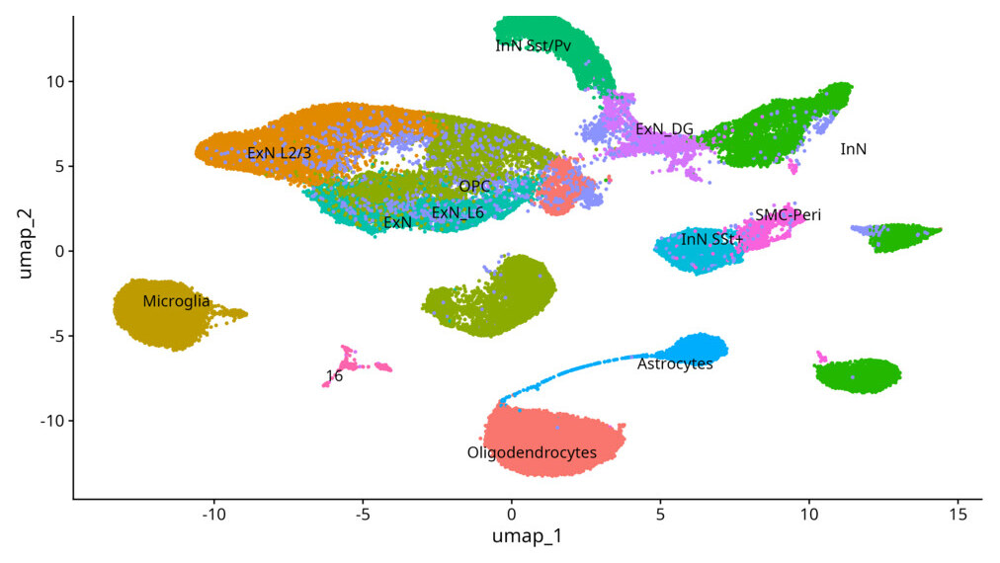
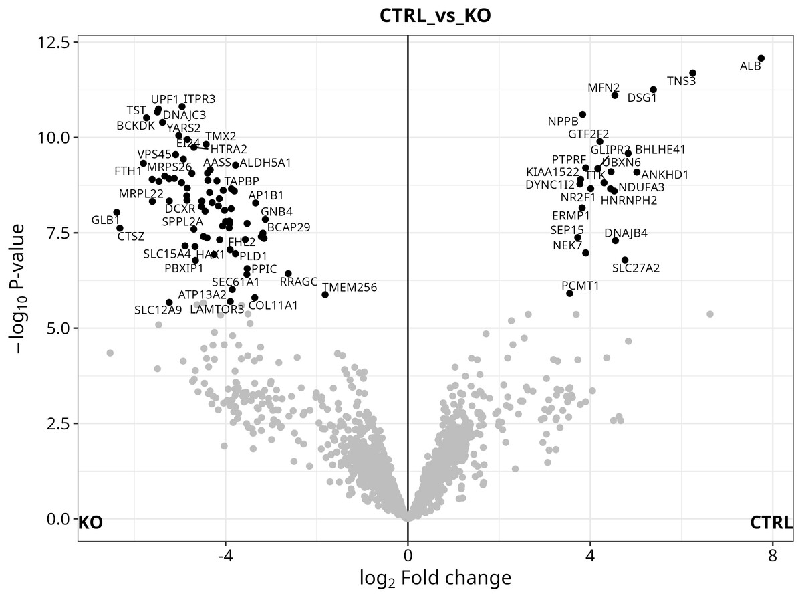
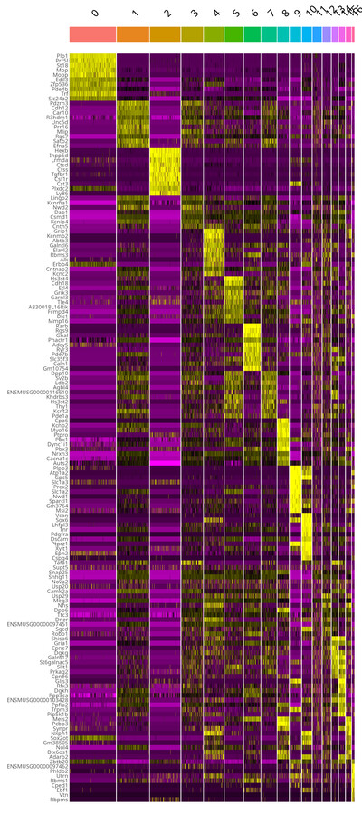
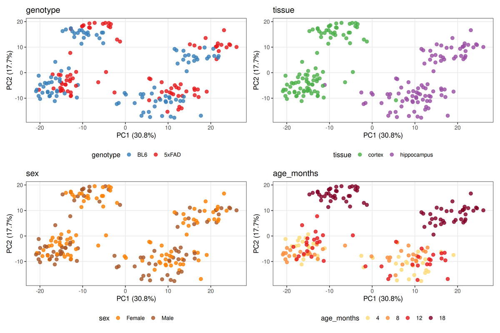
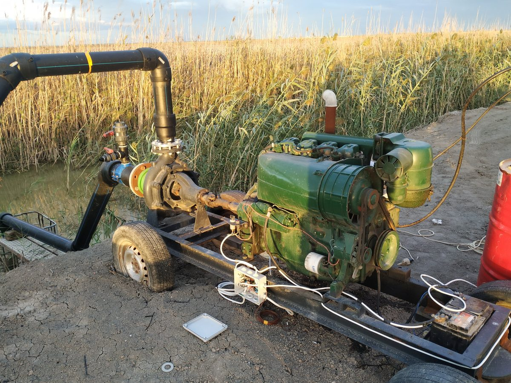

<!-- Hero -->
<section class="lp-hero">
  

    

      Biomedical data science consulting
      <h1>Reproducible analysis pipelines for <em>neurotech</em> and biomedical teams.</h1>
      
From raw recordings and mass-spec output to documented, validated results your team can rerun.

      

        <a class="lp-btn lp-btn-primary" href="#contact">Let's talk &rarr;</a>
        <a class="lp-btn lp-btn-ghost" href="#projects">See the work</a>
      

      

        15+ years experimental neuroscience
        First author, Science Advances
        R &amp; Python
      

    

    

      
<i></i><i></i><i></i><b>snrna-seq / seurat / cell types</b>

      

        
      

      
UMAP &middot; manual cell-type annotation<strong>Reproducible R pipeline</strong>

    

  

</section>

<!-- Proof strip -->

  

    

90<small>%</small>

less electrophysiology processing time with an automated pipeline (IBiS, Seville)

    

70<small>%</small>

less omics data-cleaning time with automated R scripts (LCSB, University of Luxembourg)

    

27<small>%</small>

of 336 financial ML models showed real predictive value under rigorous validation

  

<!-- Services -->
<section class="lp-sec" id="services">
  

    

      Services
      <h2>What I build for your team.</h2>
      
Three ways to work together, each ending in something you can run and keep.

    

    

      

        
<i class="fas fa-wave-square"></i>

        <h3>Electrophysiology &amp; signal pipelines</h3>
        
Raw patch-clamp, EEG or MEA recordings to reproducible, documented outputs, with QC and artifact rejection built in.

        <a class="lp-svc-link" href="/projects/ephys-pipeline">See the pipeline &rarr;</a>
        
<b>Deliverable</b>Working pipeline + technical documentation

      

      

        
<i class="fas fa-clipboard-check"></i>

        <h3>Pipeline design &amp; audit</h3>
        
Code review, statistical validation and reproducibility gap analysis for teams preparing regulatory or quality submissions.

        
<b>Deliverable</b>Audit report + remediation roadmap

      

      

        
<i class="fas fa-dna"></i>

        <h3>Omics data analysis</h3>
        
Label-free proteomics, scRNA-seq and ML biomarker discovery, from MaxQuant or CellRanger output to interpretation.

        <a class="lp-svc-link" href="/projects/proteomics">Proteomics</a>
        
<b>Deliverable</b>Analysis report + R/Python scripts

      

    

  

</section>

<!-- Projects -->
<section class="lp-sec lp-flush" id="projects">
  

    

      Selected work
      <h2>Pipelines in production.</h2>
    

    

      <a class="lp-card lp-c-big" href="/projects/proteomics">
        

        

          
&minus;70%

          <h3>Automated proteomics pipeline for neurodegeneration biomarkers</h3>
          
MaxQuant LFQ cleaning, normalisation, differential expression and ML biomarker discovery. Deployed at LCSB, University of Luxembourg.

          
ProteomicsRMaxQuant

        

      </a>
      <a class="lp-card lp-c-sm" href="/projects/ephys-pipeline">
        

          <svg width="190" height="80" viewBox="0 0 190 80" fill="none"><path d="M2 58 L26 58 L40 8 L58 70 L74 52 L110 58 L124 20 L138 64 L150 54 L188 56" stroke="currentColor" stroke-width="2" stroke-linejoin="round" stroke-linecap="round"/><circle cx="40" cy="8" r="4" fill="#E07050"/></svg>
        

        

          
Work in progress

          <h3>Electrophysiology analysis pipeline</h3>
          
Patch-clamp mIPSCs, mEPSCs and FI curves with miniML event detection.

          
PythonR

        

      </a>
      <a class="lp-card lp-c-third" href="/projects/single-cell">
        

        

          <h3>snRNA-seq analysis pipeline</h3>
          
10X CellRanger to SCTransform, clustering, differential expression and functional enrichment.

          
SeuratR

        

      </a>
      <a class="lp-card lp-c-third" href="/bulk-rnaseq-deseq2-alzheimer/">
        

        

          <h3>Bulk RNA-seq with DESeq2 and edgeR</h3>
          
192 5xFAD Alzheimer mouse samples (GSE168137): design formula, fold-change shrinkage and a DESeq2-vs-edgeR cross-check. Written up as a blog post.

          
DESeq2edgeRR

        

      </a>
      <a class="lp-card lp-c-third" href="/projects/ibex35-prediction">
        
27%of 336 model and horizon combinations showed real predictive value

        

          <h3>ML validation framework for financial time series</h3>
          
A case study in avoiding false discovery: McNemar, Diebold-Mariano and bootstrap confidence intervals. A documented negative result with a reproducible pipeline.

          
Machine learningTime seriesPythonR

        

      </a>
    

    
<a href="{{ site.social.github }}" target="_blank" rel="noopener">View all on GitHub &rarr;</a>

  

</section>

<!-- Side project -->
<section class="lp-sec lp-flush" id="side-projects">
  

    

      Side project
      <h2>Beyond the lab.</h2>
      
Embedded hardware and IoT, away from biomedical data.

    

    

      <a class="lp-card lp-c-big lp-c-wide" href="/projects/agriot">
        

        

          
&minus;86%

          <h3>Remote monitoring for a 1972 diesel engine</h3>
          
Custom LoRa system for remote start/stop and live telemetry (voltage, oil pressure, RPM, fuel) from 2+ km away. 86% fewer site visits, 99.2% uptime over 6 months, under &euro;150 total cost.

          
EmbeddedIoTLoRaPCB designC/C++

        

      </a>
    

  

</section>

<!-- About -->
<section class="lp-sec lp-about" id="about">
  

    
    

      About
      <h2>Experimentalist who writes production code.</h2>
      
I'm Santiago López Begines, a neuroscientist and data scientist with 15+ years in biomedical research and 5+ in machine learning, multi-omics and data pipelines.

      
First author in <strong>Science Advances</strong> (2025), co-author of 8+ papers in EMBO Journal, eLife and Cell Death &amp; Disease. A deep wet-lab background in patch-clamp, proteomics and transgenic models, combined with <strong>Python</strong> and <strong>R</strong> at production level.

      

        <a href="/publications">Publications &rarr;</a>
        <a href="/blog">Blog &rarr;</a>
        <a href="/assets/cv/CV_Santiago_Lopez_Begines.pdf" download>Download CV</a>
      

    

  

</section>

<!-- Contact -->
<section class="lp-sec lp-flush lp-contact" id="contact">
  

    

      

        Contact
        <h2>Let's build something reproducible.</h2>
        
Available for collaborations in neurotech, MedTech and biomedical data science. Tell me about your data and what you need to deliver.

        

          <a href="{{ site.social.linkedin }}" target="_blank" rel="noopener"><i class="fab fa-linkedin"></i> LinkedIn</a>
          <a href="{{ site.social.github }}" target="_blank" rel="noopener"><i class="fab fa-github"></i> GitHub</a>
          <a href="{{ site.social.orcid }}" target="_blank" rel="noopener"><i class="fab fa-orcid"></i> ORCID</a>
        

      

      <form action="https://formspree.io/f/xnjgpjov" method="POST" class="lp-form">
        <label class="lp-sr" for="lp-name">Name</label>
        <input id="lp-name" type="text" name="name" placeholder="Name" autocomplete="name" required>
        <label class="lp-sr" for="lp-email">Email</label>
        <input id="lp-email" type="email" name="email" placeholder="Email" autocomplete="email" required>
        <label class="lp-sr" for="lp-message">Message</label>
        <textarea id="lp-message" name="message" placeholder="Message" required></textarea>
        <button type="submit" class="lp-btn lp-btn-primary">Send message</button>
      </form>
    

  

</section>

